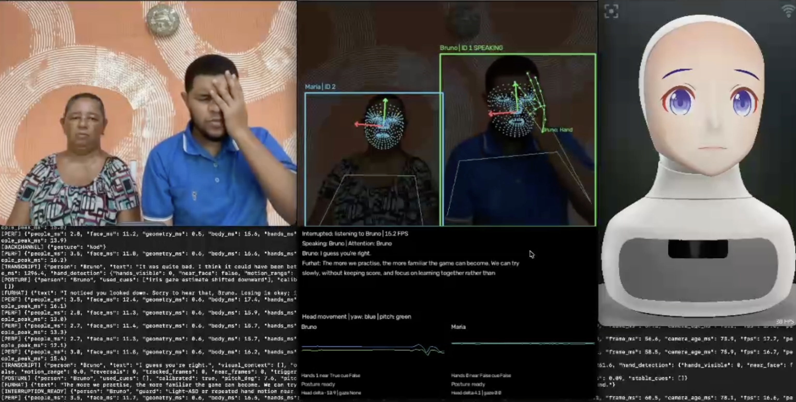

<div align="center">

# Real-Time Multimodal Interaction with Furhat

> **Disclaimer:** This is a proof of concept developed for a demo using AI tools. A fully tested and manually reviewed final version will be released soon.

**See · Listen · Understand · Respond**

A lightweight Python toolkit for natural, multimodal interaction with individuals and groups.


[](LICENSE)


[🚀 Setup](#setup) · [▶️ Run](#run) · [🧠 Models](#models) · [✨ Capabilities](#capabilities) · [🛠️ Architecture](docs/architecture.md)

</div>



*Recorded interaction on an 8 GB MacBook Air: clean camera view on the left, tracked participants and visual cues in the middle, Virtual Furhat on the right.*

<a id="capabilities"></a>

## ✨ What it does

| Capability | Behavior |
|---|---|
| 👀 Visual attention | Detect participants, follow them and direct the robot toward the person being addressed. |
| 🎙️ Active-speaker detection | Combine audio and face video to associate a spoken turn with a tracked participant. |
| 💬 Conversation | Transcribe speech locally and give the language model speech, names and observed visual context. |
| 🥤 Object awareness | Recognize objects and acknowledge the object a newcomer brings into the interaction. |
| ✋ Gestures and games | Detect hand signs, associate hands with participants and score three rock–paper–scissors rounds. |
| 🙂 Responsive behavior | Use head movement, approximate gaze and hand cues; nod while listening and handle experimental interruptions during conversation. |
| 🤖 Embodied responses | Use Furhat's native voice, lip synchronization, head movement and facial gestures. |

Supports one or two participants. Speech is turn based, with experimental interruption handling.

<a id="setup"></a>

## 🚀 Setup

Install **Python 3.12**, the **Furhat SDK**, and **[Ollama](https://ollama.com/)** for local language generation. Start Virtual Furhat, enable its Realtime API, and select a voice.

```bash
git clone https://github.com/BrunoMelicio/real-time-multimodal-furhat.git
cd real-time-multimodal-furhat
python3.12 -m venv .venv
.venv/bin/python -m pip install -r requirements.txt
.venv/bin/python tools/setup_models.py --download
.venv/bin/python main.py --check
```

**Local Ollama is the default; no API key is needed.** Download the default model:

```bash
ollama pull llama3.2:1b
```

Keep Ollama running. Cloud providers are optional and do not require Ollama; see [API keys](#language-providers).

<a id="run"></a>

## ▶️ Run

```bash
# One participant
.venv/bin/python main.py --people=1 --mic=builtin

# Two participants
.venv/bin/python main.py --people=2 --mic=builtin
```

Press **Space** in the preview to start; **Q / Esc** to quit. Allow camera and microphone access. A two-person session can begin before the second participant joins.

Introduce yourself, chat, or ask to play rock–paper–scissors. Nods and head shakes can answer questions; hand signs determine game scores.

| Option | Purpose |
|---|---|
| `--mic=iphone` | Use an iPhone microphone instead of the built-in input. |
| `--llm=ollama` / `groq` / `openai` / `compatible` | Choose the language provider. |
| `--llm-model=MODEL_ID` | Choose its model. |
| `--asr=whisper-base` / `whisper-tiny` / `whisper-small` / `whistle` / `phonon` | Choose local speech recognition; Whisper Base is the default. |
| `--barge-in=visual` / `vad` | Default face/audio checks reduce robot echo; speech-only VAD may hear Furhat's own voice. |

Whistle and Phonon need the optional runtimes below; Phonon uses Apple Silicon. Model weights may download on first use.

```bash
.venv/bin/python -m pip install -r requirements-asr.txt
```

Use `main.py --help` for all options. The app saves no recordings.

<a id="language-providers"></a>

### API keys (optional)

Copy `.env.example` to `.env` in the project folder and add your key. For **Groq**:

```dotenv
GROQ_API_KEY=paste_your_key_here
```

```bash
.venv/bin/python main.py --people=2 --llm=groq --llm-model=openai/gpt-oss-20b
```

For **OpenAI**, set `OPENAI_API_KEY` and use `--llm=openai --llm-model=YOUR_MODEL_ID`. Other compatible APIs use `LLM_API_KEY`, `--llm=compatible`, and `--llm-base-url=YOUR_API_URL` with a model ID.

The app loads `.env` automatically; Git excludes it. Add `--check-llm` to test the provider without devices. Cloud providers receive text context; raw audio and camera frames stay local.

<a id="models"></a>

## 🧠 Models

| Component | Model / service |
|---|---|
| People | YOLO26 Nano |
| Face, head, body and hands | MediaPipe |
| Objects | EfficientDet-Lite0 (default) or SSD MobileNetV2 / Lite2 |
| Speech activity / speaker matching | Silero VAD / Light-ASD |
| Transcription | Whisper, Whistle or Phonon-2 |
| Language | Ollama / Llama 3.2 1B (default), or a cloud provider |
| Voice and lip sync | Furhat native speech |

Developed on a **MacBook Air M3, 8 GB RAM**, with **Virtual Furhat SDK 2.9.3**. Detection and tracking are approximate; live behavior remains experimental.

## 🧪 Tests

```bash
.venv/bin/python -m unittest discover -s tests -v
```

Tests use synthetic inputs and mocks; they do not open devices or run model inference.

## 📚 Details and license

- [Architecture and limitations](docs/architecture.md)
- [Third-party models and licenses](docs/third_party.md)
- [MIT license](LICENSE) for original code; dependencies and model weights retain their own licenses.

**Planned:** larger groups, a Hugging Face Spaces demo, other robot adapters, full-duplex conversation, and broader live validation.
