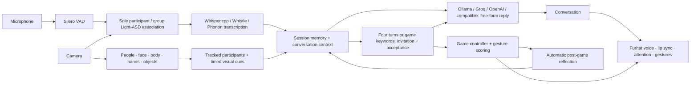

# 🛠️ Continuous multimodal interaction

## ⚙️ How the app runs

1. **Load once:** `main.py` starts one session with shared camera, perception, audio, transcription and dialogue owners. Required models are reused across conversation, games and reflection.
2. **Observe continuously:** people, faces, approximate gaze, body pose, hands and objects remain active. Participant capacity currently accepts one or two; larger groups are planned.
3. **Associate speech and interrupt Furhat:** VAD finds speech boundaries. Both people modes monitor participant speech during robot playback. With `--barge-in=vad`, sustained speech stops Furhat immediately and speaker attribution finishes while listening. The default `visual` guard also checks Light-ASD face/audio evidence to reduce robot-echo triggers. Listening uses a sole fresh visible face directly, or Light-ASD with multiple faces, in either configured capacity. Identity evidence comes from **during speech**, not the camera frame after transcription. No overlapping participant speech separation is attempted. Empty transcriptions are ignored.
4. **Build context:** send the selected language provider the named participant's speech, recent conversation, observed visual cues, object association and actual game results. Local Ollama is the default; cloud providers receive this textual context, not raw audio/video.
5. **Chat and invite:** one free-form LLM call generates each conversational reply. After four conversational turns, or earlier when speech mentions play, games or fun, that reply naturally invites the participant to play rock–paper–scissors. Acceptance or an explicit request to play enters setup; declining continues conversation. Collective rules answers apply to the group question; individual answers prompt remaining players. Requests to proceed can enter hand release after a short rules explanation. Setup responses always stay with the controller, so unclear speech cannot fall through to improvised LLM gameplay. Pending group game controls can consume an unattributed reply without fabricating speaker identity. Python handles the invitation state, rounds and scoring. There is no separate LLM intent classifier or evidence-quote protocol.
6. **Reflect and continue:** keep results in memory, ask about the game and return to ongoing conversation. No external winner argument or separate reflection launch is needed.

The new continuous integration has offline state/routing tests; **live end-to-end validation is still pending**. Standalone component demonstrations remain available independently.

## 🧠 Upstream components

| Component | Official source | Use here |
|---|---|---|
| People/tracks | [Ultralytics YOLO](https://github.com/ultralytics/ultralytics) | Nano person detector and short-term tracking |
| Face, body and hands | [MediaPipe](https://github.com/google-ai-edge/mediapipe) | Landmarks, gesture labels and calibrated relative cues |
| Objects | [TensorFlow Object Detection](https://github.com/tensorflow/models/tree/master/research/object_detection), [EfficientDet](https://github.com/google/automl/tree/master/efficientdet) | SSD / EfficientDet-Lite via MediaPipe |
| Voice activity | [Silero VAD](https://github.com/snakers4/silero-vad) | Speech segmentation and interruption evidence |
| Active speaker | [Light-ASD](https://github.com/Junhua-Liao/Light-ASD) | Match speech activity with visible face video |
| ASR | [Whisper](https://github.com/openai/whisper), [Whistle](https://cactuscompute.com/blog/whistle), [Phonon-2](https://huggingface.co/FermionResearch/Phonon-2) | Local selectable speech recognition; CPU Whisper/Whistle or Apple Silicon MLX Phonon |
| Language | [Llama](https://github.com/meta-llama/llama-models) via [Ollama](https://github.com/ollama/ollama) | Conversation and semantic game decisions; Built with Llama by default |
| Smaller language fallback | [Gemma](https://github.com/google/gemma_pytorch) | Optional locally installed 270M model |
| Cloud language alternatives | [Groq](https://console.groq.com/docs/openai), [OpenAI](https://developers.openai.com/api/reference/resources/chat) | Free-form Chat Completions; provider API keys load from the ignored project `.env` or shell environment |
| Robot interface | [Furhat Realtime API](https://docs.furhat.io/realtime-api/intro) | Native speech, lip sync, head attention and facial gestures |

## ⏱️ Responsiveness and ownership

- A latest-frame camera avoids stale video queues.
- Audio analysis and transcription run separately from the preview; small queues limit backlogs.
- Uncertain speaker attribution asks for a repeat. One fresh visible face supplies identity in either configured capacity. Blank transcriptions never trigger a repeat request or interrupt the game.
- Hand ownership uses matching body wrists first, then clear person regions when pose wrists are missing, regardless of configured capacity. Ambiguous, overlapping, duplicate or distant assignments are rejected; uncertainty reasons appear in the overlay.
- Head answers use the speech response path for invitations, rules and conversational questions. All frames update the visible roster and buffer recent head events even during playback/listening delays. A new robot turn clears old responses; speech supersedes buffered gestures. Head-motion smoothing is time-based and tolerates inference intervals up to 0.6 seconds.
- One-person robot moves are randomly committed before reading the person's hand. Group scores come from observed signs.
- A listening nod is throttled; head-follow commands briefly pause so the acknowledgment stays visible.
- Conversation memory and visible dialogue are bounded. No recordings or run reports are saved by the continuous app.
- `--profile` reports perception/render/display timings. ASR logs report decode and final-after-voice delays; FPS alone does not describe conversational latency.

Participants take turns, and either participant can interrupt Furhat in either people mode. The speech worker cancels the old utterance without advancing its scene, retains the new utterance's onset, and includes the interruption in the next reply's context. Greetings, invitations, instructions and follow-ups use the same interruptible playback path. Interrupted game rounds are rearmed after the new turn is answered. VAD-only mode has no acoustic echo cancellation; visual face/audio matching is the default echo guard. Human speech overlap/separation remains outside this release.

## 📜 Licensing

Original project code uses [MIT](../LICENSE). **Dependencies and model weights retain their own licenses**; check them before deploying or distributing a combined system. See [third-party notices](third_party.md), particularly YOLO's AGPL/Enterprise terms and Llama's Community License.

[← Back to the README](../README.md)
